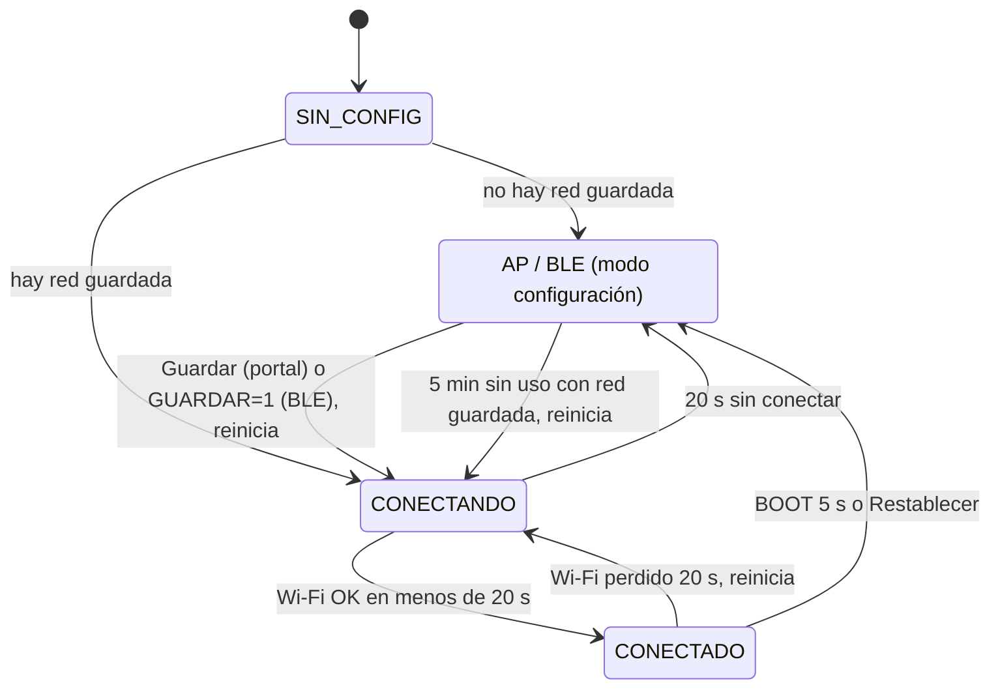

# Raulcito bracito: ESP32 con portal web y configuración por Bluetooth

PIA de Robótica y Domótica (UANL). El robot es un **brazo robótico con pinza y tapa**, sin chasis ni ruedas. El **ESP32** es el cerebro: lee sensores, manda órdenes al **Arduino Uno**, se conecta a **Alexa** mediante **SinricPro** y registra eventos en la base de datos (`guardar.php`).

Este firmware ya **no tiene credenciales en el código**. El Wi-Fi, las claves de SinricPro, la URL de la API y el PIN del panel se capturan desde:

- un **portal web** propio (red `Raulcito-Setup`), o
- **Bluetooth (BLE)** con la app gratuita **nRF Connect**.

Una vez conectado, el robot se controla desde **internet** en **https://raulcito-bracito.web.app** (desde cualquier lugar, con cuenta del equipo) y también desde un **panel local** de respaldo en `http://raulcito.local` (misma red Wi-Fi).

> Alexa controla al ESP32 **por Wi-Fi, a través de SinricPro**, no por Bluetooth. El Bluetooth solo sirve para **configurar** el Wi-Fi y las claves desde el celular.

---

## 1. Hardware y pines

### Arduino Uno (Hardware en tiempo real: sensores y actuadores a 5V nativos)

| Elemento | Pin Arduino Uno | Notas |
|---|---|---|
| HC-SR04 TRIG / ECHO | Pin 2 / Pin 4 | 5V nativos sin divisor resistivo |
| PIR (Movimiento) | Pin 10 | Entrada digital |
| LDR (Luz ambiental) | Pin A0 | Entrada analógica (0–1023) |
| Servo Base | Pin 3 | PWM |
| Servo Hombro | Pin 5 | PWM |
| Servo Codo | Pin 6 | PWM |
| Servo Pinza | Pin 9 | PWM |
| Puente H L298N (Tapa del baúl) | ENA = 11, IN1 = 12, IN2 = 13 | Motor DC de apertura/cierre |
| Botón físico de paro | A1 a GND | Pulsador normalmente abierto; interrumpe movimientos del brazo y detiene la tapa mientras se mantiene presionado |
| UART hacia ESP32 (`SoftwareSerial`) | Pin 7 (RX ← GPIO17 ESP32), Pin 8 (TX → GPIO16 ESP32, con divisor de voltaje), GND común | 9600 baud; el pin TX del Uno es de 5 V y requiere reducirse a 3.3 V antes del ESP32 |

### ESP32 (Cerebro de conectividad: Wi-Fi, Alexa y Firebase)

| Elemento | Pin ESP32 | Notas |
|---|---|---|
| UART al Arduino (Serial2) | RX2 = GPIO16 (← pin 8 Arduino mediante divisor), TX2 = GPIO17 (→ pin 7 Arduino), GND común | 9600 baud |
| Botón BOOT (borrar configuración) | GPIO0 | Presionar 5 s para modo AP |
| LED de estado | GPIO2 | Azul (conectando / AP / fijo conectado) |

Comandos del Arduino: `RECOGER`, `REPOSO`, `PING`, movimiento coordinado (`BRAZO_SUBIR`, `BRAZO_BAJAR`), articulaciones (`BASE_IZQ`, `BASE_DER`, `HOMBRO_ARR`, `HOMBRO_ABA`, `CODO_ARR`, `CODO_ABA`), pinza (`PINZA_POS_<20–90>` para su apertura gradual), tapa y `STOP`. Mantén presionados los controles de articulación para mover y suéltalos para parar. Telemetría de sensores: `DAT:<dist>,<pir>,<luz>`.

---

## 2. Qué necesitas instalar

### Placa y esquema de particiones

| Ajuste en Arduino IDE (menú **Herramientas**) | Valor |
|---|---|
| Core | **esp32 de Espressif Systems 3.x** (probado con **3.3.12**) |
| Placa | **ESP32 Dev Module** (`esp32:esp32:esp32`) |
| Partition Scheme | **Huge APP (3MB No OTA/1MB SPIFFS)** |

> ⚠️ **Selecciona la partición "Huge APP".** Wi-Fi, BLE y SinricPro juntos no caben en la partición por defecto (1.2 MB) y la compilación falla con *"Sketch too big"*.

Se usa Arduino IDE 2.x (no PlatformIO).

### Librerías

Instálalas desde **Sketch → Include Library → Manage Libraries…**

| Librería | Versión probada | Autor | Notas |
|---|---|---|---|
| **SinricPro** | 5.1.0 | Boris Jaeger | Conexión con Alexa |
| **WebSockets** | 2.7.2 | Markus Sattler | Dependencia de SinricPro (se instala con ella) |
| **ArduinoJson** | 7.4.3 | Benoit Blanchon | Se requiere la versión **7** |
| **NimBLE-Arduino** | 2.5.2 | h2zero | Se requiere la versión **2.x**, porque la API de callbacks cambió respecto a la 1.x |

Incluidas en el core esp32 3.3.12 (no se instalan aparte): `WiFi`, `WebServer`, `DNSServer`, `ESPmDNS`, `Preferences`, `HTTPClient`.

### Archivos del firmware (`esp32_raulcito/`)

| Archivo | Qué hace |
|---|---|
| `esp32_raulcito.ino` | Lógica del robot (sensores, Arduino, SinricPro, registro HTTP) y la máquina de estados del Wi-Fi |
| `config.h / config.cpp` | Lee, guarda, borra y valida la configuración en la NVS (`Preferences`) |
| `portal.h / portal.cpp` | Servidor web, portal cautivo (DNS), API JSON, PIN y buffer de los últimos 20 eventos |
| `ble_setup.h / ble_setup.cpp` | Servicio GATT de configuración por BLE (NimBLE) |
| `nube.h / nube.cpp` | Conexión con la página de internet (Firebase): sube el estado, recibe órdenes y configuración |
| `web_ui.h` | Página del panel local (HTML, CSS y JS embebidos, unos 20 KB, sin CDNs) |

### Archivos de la página de internet (raíz del repo)

| Archivo | Qué hace |
|---|---|
| `pagina_web/` | La página publicada en Firebase Hosting (`index.html`, `css/`, `js/app.js`) |
| `database.rules.json` | Reglas de seguridad de la base de datos (quién puede leer o escribir cada cosa) |
| `firebase.json`, `.firebaserc` | Configuración del proyecto Firebase `raulcito-bracito` |

### Compilar y subir

1. Abre `esp32_raulcito/esp32_raulcito.ino` en Arduino IDE 2.x.
2. Elige la placa, el puerto y la partición **Huge APP**.
3. Haz clic en **Subir**. Después abre el **Monitor Serie a 115200 baud**.

Con `arduino-cli`:

```bash
arduino-cli compile --fqbn esp32:esp32:esp32:PartitionScheme=huge_app esp32_raulcito
arduino-cli upload  --fqbn esp32:esp32:esp32:PartitionScheme=huge_app -p COM5 esp32_raulcito
```

---

## 3. Primer uso: configurar el robot

Sin configuración guardada, el ESP32 entra en **modo configuración**: el LED parpadea lento, levanta la red Wi-Fi **`Raulcito-Setup`** y anuncia **`Raulcito-BLE`** por Bluetooth. Elige una de las dos opciones.

> El ESP32 solo se conecta a redes de **2.4 GHz**.

Ten a la mano los datos de SinricPro (en [sinric.pro](https://sinric.pro), sección *Credentials* y *Devices*):
- **APP_KEY** (36 caracteres) y **APP_SECRET** (73 caracteres).
- **Device ID** (24 caracteres) de cada dispositivo: Switch *Raulcito*, Motion *Movimiento* y Contact *Oscuridad*.

### Opción A: portal web (Wi-Fi)

1. En el celular, conectate a **`Raulcito-Setup`** con la clave fija **`raulcito123`**.
2. La página de configuración se abre sola (portal cautivo). Si no aparece, abre **http://192.168.4.1** en el navegador. Si el celular dice "sin internet", elige **mantener la conexión**.
3. Toca **Buscar**, elige tu red de la lista (muestra la intensidad de la señal) o escribe el nombre a mano.
4. Escribe la **contraseña del Wi-Fi** y define un **PIN personal de 4 dígitos** para el panel.
5. Revisa el **nombre del robot** (por defecto `raulcito-01`) y la **URL de la API**, por ejemplo `http://192.168.1.10/raulcito/guardar.php`.
6. Captura **APP_KEY**, **APP_SECRET** y los **3 Device IDs**. Si dejas vacío SinricPro, el robot funciona sin Alexa.
7. Toca **Guardar y conectar**. El ESP32 guarda todo en la NVS y se reinicia. El LED parpadea rápido mientras se conecta y queda **fijo** cuando ya está conectado.
8. Conecta el celular a tu red normal y abre **http://raulcito.local**. Para controlarlo desde cualquier lugar, vincúlalo a la página de internet (sección 4).

Mientras el robot está en modo configuración, la página también muestra los sensores y los botones, así que puedes probar el hardware sin tener Wi-Fi.

### Opción B: Bluetooth con nRF Connect

Instala **nRF Connect for Mobile** (Nordic Semiconductor), gratis en Android e iOS.

#### UUIDs del servicio

Servicio: **`7a1e0000-7261-756c-6369-746f00000000`**

| Característica | UUID | Propiedades | Valor |
|---|---|---|---|
| SSID | `7a1e0001-7261-756c-6369-746f00000000` | Escribir, Leer | Nombre de la red Wi-Fi |
| PASSWORD | `7a1e0002-7261-756c-6369-746f00000000` | Escribir | Contraseña del Wi-Fi |
| APP_KEY | `7a1e0003-7261-756c-6369-746f00000000` | Escribir | APP_KEY de SinricPro |
| APP_SECRET | `7a1e0004-7261-756c-6369-746f00000000` | Escribir | APP_SECRET de SinricPro |
| ID_ROBOT | `7a1e0005-7261-756c-6369-746f00000000` | Escribir, Leer | Device ID del Switch *Raulcito* |
| ID_PIR | `7a1e0006-7261-756c-6369-746f00000000` | Escribir, Leer | Device ID del Motion *Movimiento* |
| ID_LDR | `7a1e0007-7261-756c-6369-746f00000000` | Escribir, Leer | Device ID del Contact *Oscuridad* |
| URL_API | `7a1e0008-7261-756c-6369-746f00000000` | Escribir, Leer | URL de `guardar.php` |
| PIN *(obligatorio)* | `7a1e0009-7261-756c-6369-746f00000000` | Escribir | PIN personal de 4 digitos para el panel |
| NOMBRE *(opcional)* | `7a1e000a-7261-756c-6369-746f00000000` | Escribir, Leer | Nombre del robot (`raulcito-01`) |
| **GUARDAR** | `7a1e00f0-7261-756c-6369-746f00000000` | Escribir | Escribe `1` para probar, guardar y reiniciar |
| **ESTADO** | `7a1e00f1-7261-756c-6369-746f00000000` | Leer, Notificar | `ESPERANDO`, `CONECTANDO`, `OK:<IP>` o `ERROR:<motivo>` |

Cada característica tiene una descripción (descriptor 0x2901) con su nombre, así que nRF Connect muestra "SSID", "PASSWORD", etc. bajo cada UUID.

#### Paso a paso

1. Comprueba que el ESP32 está en modo configuración (LED con parpadeo lento).
2. Abre nRF Connect y, en la pestaña **Scanner**, toca **Scan**. Busca **`Raulcito-BLE`** y toca **Connect**.
3. Abre el servicio **`7a1e0000-…`** (aparece como *Unknown Service*).
4. En **ESTADO** (`…00f1`), toca el ícono de **notificaciones** (tres flechas hacia abajo) para suscribirte. Con la flecha de lectura debe aparecer `ESPERANDO`.
5. En cada característica toca la flecha **↑ (escribir)**, elige el formato **TEXT** (en Android) o **UTF8** (en iOS), escribe el valor y toca **Send**. Escribe en este orden:
   1. **SSID**
   2. **PASSWORD**
   3. **APP_KEY** y **APP_SECRET**
   4. **ID_ROBOT**, **ID_PIR** e **ID_LDR**
   5. **URL_API**
   6. **PIN** (obligatorio) y *(opcional)* **NOMBRE**
6. En **GUARDAR** (`…00f0`), escribe `1` (como TEXT o como byte `01`).
7. Observa **ESTADO**:
   - `CONECTANDO`: el ESP32 está probando la red (hasta 20 s).
   - `OK:192.168.1.50`: se conectó. **Anota la IP**. La configuración se guarda y el ESP32 se reinicia en 5 s.
   - `ERROR:<motivo>`: no se guardó nada. Corrige el campo indicado y vuelve a escribir `1` en GUARDAR.
8. Abre **http://raulcito.local** (o la IP anotada) con el celular conectado a la misma red.

Notas:
- Los campos secretos (PASSWORD, APP_KEY, APP_SECRET, PIN) **solo se pueden escribir**, no leer.
- Si no escribes un campo, se conserva lo que ya estaba guardado.
- Si un texto largo (APP_SECRET) se corta, en Android usa el menú ⋮ → **Request MTU** (517) antes de escribir.

---

## 4. Página de internet: https://raulcito-bracito.web.app

Desde aquí se hace todo, en cualquier lugar: ver los sensores en vivo, mandar comandos, revisar los eventos, cambiar la configuración de SinricPro y administrar quién entra.

```
 Celular / compu (cualquier lugar)            ESP32 (en casa o en la escuela)
 raulcito-bracito.web.app  ◄──►  Firebase  ◄──►  sube su estado cada 1 s y
 sensores · botones · eventos    (nube)          ejecuta las órdenes que llegan
 · configuración · equipo
```

### Entrar por primera vez

1. Abre **https://raulcito-bracito.web.app** y toca **Crear una** cuenta, con tu correo y una contraseña. Entras de inmediato, sin correo de verificación.
2. Solo entran los correos que están en el **Equipo**. Ya están dados de alta como administradores `david.rvrcls@gmail.com` y `andre.riverac@uanl.edu.mx`.
3. Para agregar a tus compañeros, ve a **Equipo → Agregar persona**, escribe su correo y marca *Administrador* si también podrá vincular el robot y agregar gente. Después, cada quien crea su cuenta con ese correo.

> Como no se verifica el correo, cualquiera que sepa un correo del Equipo que **todavía no tiene cuenta** podría registrarse con él. Pide a cada persona que cree su cuenta en cuanto la agregues: una vez creada, nadie más puede usar ese correo.

### Vincular el robot (una sola vez)

El robot no lleva contraseñas de Firebase en el código: la primera vez que se conecta a internet **se crea su propia cuenta** y pide permiso con un **código de 6 dígitos**.

1. Configura el Wi-Fi del robot (sección 3).
2. Ya conectado, el robot muestra el código en el **Monitor Serie**:
   ```
   [NUBE] Esperando vinculación desde https://raulcito-bracito.web.app · código 482193
   ```
   El código también aparece en `http://raulcito.local`, en *Conexión → Página web*.
3. En la página aparece la tarjeta **Vincular robot** con el mismo código. Si coincide, toca **Vincular**.
4. En unos segundos el indicador cambia a **En línea**.

Si restableces de fábrica, el robot **conserva su cuenta** y no hay que volver a vincularlo. Para cambiar de robot, vincula el nuevo (reemplaza al anterior) o usa *Configuración → Desvincular robot*.

### Qué se puede hacer

- **En vivo:** distancia, movimiento, luz, modo limpieza, brazo, último mensaje del Arduino, Wi-Fi y señal del robot, estado de SinricPro. Si el robot deja de mandar datos más de 120 s, la página lo marca **Desconectado** y desactiva los botones.
- **Botones:** *Iniciar/Detener limpieza*, *Recoger ahora*, *Reposo*, *Ping*. El robot confirma cada orden y la página muestra "Listo" o el error, por ejemplo "El brazo está ocupado". Las órdenes desde la página quedan registradas como tipo `web` y también se avisan a Alexa.
- **Configuración:** nombre, URL de la API, APP_KEY / APP_SECRET y Device IDs. Al guardar, el robot recibe los cambios, los guarda y se reinicia (unos 20 s). Las claves **no se pueden volver a leer** desde la página: si dejas los campos vacíos, se conservan.
- **La página manda:** si cambias algo en el panel local o por BLE, el robot lo sube a la página al reconectarse; pero si la página tiene otro valor guardado, gana el de la página.
- **Lo que no se puede cambiar desde internet:** el Wi-Fi y el PIN del panel local. Si el robot no tiene Wi-Fi, tampoco tiene internet, así que eso se hace en el robot (portal `Raulcito-Setup`, BLE o `raulcito.local`).

### Proyecto Firebase

- **Proyecto:** `raulcito-bracito` (plan gratuito Spark), en la cuenta `david.rvrcls@gmail.com`. Usa Realtime Database, Authentication (correo y contraseña) y Hosting.
- **Publicar cambios de la página o de las reglas** (desde la raíz del repo):
  ```bash
  firebase deploy --only hosting      # la página
  firebase deploy --only database     # las reglas
  ```
- **Datos que maneja:**

  | Ruta | Escribe | Lee |
  |---|---|---|
  | `robot/estado`, `robot/eventos`, `robot/respuesta` | el robot | el equipo |
  | `robot/ordenes/comando`, `robot/ordenes/config` | el equipo | el robot y el equipo |
  | `robot/ordenes/secretos` (APP_KEY, APP_SECRET) | el equipo y el robot | **solo el robot** |
  | `equipo`, `dispositivo`, `solicitudes` | administradores | el equipo / administradores |

  La `apiKey` que aparece en `pagina_web/js/firebase-config.js` y en `nube.cpp` **no es secreta**: Firebase la usa para identificar el proyecto. Quién puede hacer qué lo deciden las reglas de `database.rules.json`.

---

## 5. Panel local (respaldo)

Sirve en la misma red Wi-Fi del robot, aunque no haya internet.

- **Dirección:** **http://raulcito.local**, o la IP que imprime el Monitor Serie al arrancar:
  ```
  Wi-Fi OK: 192.168.1.50  (red "MiCasa")
  Panel: http://raulcito.local  o  http://192.168.1.50
  ```
  Algunos Android antiguos no resuelven `.local`. En ese caso usa la IP.
- **PIN personal de 4 dígitos, obligatorio.** No hay PIN predeterminado. Después de **5 intentos fallidos** hay un bloqueo de **30 s**.
- **En vivo** (se refresca cada 1 s):
  - Distancia en cm, movimiento (PIR) y luz (0–4095, claro u oscuro).
  - Wi-Fi (red, señal en dBm, IP), estado de SinricPro, hora.
  - Modo limpieza, estado del brazo y último mensaje del Arduino.
- **Botones:** *Iniciar/Detener limpieza*, *Recoger ahora*, *Reposo* y *Ping al Arduino* (la respuesta `OK:PONG` aparece en "Último mensaje").
- **Últimos 20 eventos**, guardados en la RAM del ESP32.
- **Configuración:** permite editar los mismos datos del portal. Las contraseñas guardadas **no se muestran**: si dejas un campo secreto vacío, se conserva el valor guardado. Al guardar, el ESP32 se reinicia y la página se reconecta sola.
- **Alexa sincronizada:** cuando inicias o detienes la limpieza desde el panel, también se avisa a SinricPro (`sendPowerStateEvent`), así que la app de Alexa muestra el estado correcto. Y si dices "Alexa, enciende Raulcito", el panel lo refleja en el siguiente refresco.

---

## 6. Restablecer de fábrica

Tienes dos formas de hacerlo:

- **Botón BOOT:** con el robot ya encendido, mantén presionado **BOOT 5 segundos**. El LED parpadea muy rápido; **suelta el botón** y el ESP32 se reinicia en modo configuración.
- **Desde el panel:** ve a **Configuración → Restablecer de fábrica** y confirma.

> No mantengas BOOT presionado al **encender** o al presionar **EN/RST**, porque el ESP32 entraría en modo de programación. Por eso el firmware espera a que sueltes el botón antes de reiniciar.

---

## 7. Estados del Wi-Fi



```
SIN_CONFIG ──(sin red)──► AP/BLE ──(guardar)──► CONECTANDO ──(OK)──► CONECTADO
                            ▲                        │                    │
                            └──(20 s sin conectar)───┘                    │
                            ▲                                             │
                            └─(falla: 20 s sin Wi-Fi → reinicia → CONECTANDO → 20 s)
```

| Estado | Qué hace | LED (GPIO2) |
|---|---|---|
| SIN_CONFIG | Arranque: lee la NVS | apagado |
| CONECTANDO | Intenta la red guardada durante 20 s | parpadeo rápido |
| CONECTADO | Página de internet, panel local `raulcito.local`, SinricPro, registro HTTP | fijo |
| AP / BLE | Red `Raulcito-Setup` + portal cautivo en 192.168.4.1 + `Raulcito-BLE`. Sensores y Arduino siguen funcionando; no hay Alexa ni registro HTTP | parpadeo lento |

- **Falla estando conectado:** si el Wi-Fi se pierde **20 s**, el ESP32 se reinicia. Así tiene una oportunidad más (por si el router solo se reinició); si sigue sin red, entra a modo AP.
- **Reintento automático:** en modo AP, si hay una red guardada y nadie usa el portal ni el Bluetooth durante 5 min, el ESP32 se reinicia para volver a intentarlo. Así no se queda "atorado" si el router tardó en volver.
- Los tiempos se ajustan en el `.ino`: `WIFI_TIMEOUT`, `AP_REINTENTO`, `BOOT_RESET`.

---

## 8. API JSON del panel local

Todas las rutas requieren el header **`X-PIN`**, excepto en modo AP. Las respuestas son JSON; los errores llegan como `{"ok":false,"error":"…"}`. Un PIN incorrecto da `401` y el bloqueo da `429`.

| Método y ruta | Descripción |
|---|---|
| `GET /api/status` | Sensores y estados: `modo`, `dist`, `pir`, `luz`, `oscuro`, `limpiando`, `brazo`, `arduino`, `sinric`, `wifi{ssid,rssi,ip}`, `hora`, `ev`… |
| `GET /api/scan` | Redes Wi-Fi. La búsqueda es asíncrona: responde `{"buscando":true}` hasta tener `{"redes":[{"ssid","rssi","segura"}]}`. `?nuevo=1` fuerza una búsqueda nueva |
| `GET /api/events` | Últimos 20 eventos `{"eventos":[{"seg","fecha","tipo","valor"}]}` |
| `POST /api/cmd` | `{"cmd":"RECOGER" \| "REPOSO" \| "PING" \| "LIMPIEZA_ON" \| "LIMPIEZA_OFF"}` |
| `GET /api/config` | Configuración **sin contraseñas**: solo indica si existen (`tiene_pass`, `tiene_key`, `tiene_secret`) |
| `POST /api/config` | Guarda y reinicia. Campos: `ssid`, `pass`, `abierta`, `pin`, `nombre`, `url`, `app_key`, `app_secret`, `id_robot`, `id_pir`, `id_ldr`. En los secretos, vacío = conservar |
| `POST /api/reset` | Restablece de fábrica y reinicia |

Ejemplos:

```bash
curl -H "X-PIN: 4821" http://raulcito.local/api/status
curl -X POST -H "X-PIN: 4821" -H "Content-Type: application/json" \
     -d '{"cmd":"LIMPIEZA_ON"}' http://raulcito.local/api/cmd
```

---

## 9. Registro de eventos (`guardar.php`)

- Se envía **el mismo JSON que antes**: `{"robot":"raulcito-01","tipo":"…","valor":"…","fecha":"AAAA-MM-DD HH:MM:SS"}`.
- Cada evento va a tres lugares: el panel local, la página de internet (últimos 20) y `guardar.php`. Los envíos corren en **tareas aparte** (con timeout), así que el `loop()` **nunca se bloquea** esperando a un servidor.
- Sin Wi-Fi (o en modo AP), el evento **solo se guarda en el buffer local** (los 20 que muestra el panel).
- Tipos nuevos: `panel` (órdenes desde `raulcito.local`) y `web` (órdenes desde la página de internet), con los valores `limpieza_inicio`, `limpieza_fin`, `recoger` y `reposo`. Los demás no cambian: `sistema`, `alexa`, `ultrasonico`, `brazo`, `tapa`, `ldr`, `pir`, `error`.
  > Si la columna `tipo` de `raulcito.sql` es un `ENUM`, agrégale los valores `panel` y `web` para que se guarden esas filas.

---

## 10. Seguridad

- **Página de internet:** solo entran cuentas cuyo correo esté en el Equipo (sin verificación de correo; ver la nota de la sección 4). Los administradores agregan o quitan gente y vinculan el robot. Las reglas de Firebase (`database.rules.json`) se aplican en el servidor, así que no se pueden saltar desde el navegador.
- **Cuenta del robot:** el robot la crea solo, con una contraseña aleatoria guardada en su NVS (namespace `nube`), y solo funciona después de que un administrador la vincula. Las conexiones a Firebase usan HTTPS con verificación de certificados (`useBuiltinCACertBundle`).
- No se imprimen las contrasenas de las redes Wi-Fi guardadas, APP_KEY, APP_SECRET ni el PIN del panel. La red temporal `Raulcito-Setup` usa la clave fija `raulcito123`.
- La librería SinricPro imprime el APP_SECRET si tiene un formato inválido. Por eso el firmware **valida el formato antes** de llamar a `SinricPro.begin()`; si no es válido, desactiva Alexa sin imprimir nada.
- Las credenciales se guardan en la NVS del ESP32 (namespace `raulcito`). El firmware usa `WiFi.persistent(false)` para que no queden copias en la NVS interna del Wi-Fi.
- El PIN de 4 digitos tiene bloqueo tras 5 intentos fallidos. El panel local usa HTTP, por lo que el PIN y los datos no viajan cifrados: usalo solo en una red Wi-Fi privada de confianza. Para configurar, conecta el celular a `Raulcito-Setup` con la clave fija `raulcito123`.
- La contraseña de `Raulcito-Setup` es fija: `raulcito123`.
- Los equipos que aún tengan el PIN antiguo `1234` arrancarán en modo configuración hasta que se guarde un PIN propio. No se borra la red guardada.
- El servicio BLE no pide emparejamiento. Por eso **solo está activo en modo configuración**, y GUARDAR solo guarda si la red Wi-Fi realmente conecta.

---

## 11. Solución de problemas

| Problema | Solución |
|---|---|
| *Sketch too big* al compilar | Selecciona **Huge APP (3MB No OTA/1MB SPIFFS)** |
| Errores de `onWrite(… NimBLEConnInfo&)` | Tienes NimBLE-Arduino 1.x; actualiza a **2.x** |
| El portal no se abre solo | Abre `http://192.168.4.1`; desactiva los datos móviles mientras configuras |
| `raulcito.local` no abre | Usa la IP del Monitor Serie (o la de `OK:<IP>` en nRF Connect) |
| No aparece mi red en la lista | El ESP32 solo ve redes de 2.4 GHz; escríbela a mano si está oculta |
| SinricPro dice "Sin configurar" | APP_KEY / APP_SECRET con formato inválido o sin Device IDs; revisa el Monitor Serie |
| No veo `Raulcito-BLE` | El BLE solo está activo en modo configuración (LED con parpadeo lento) |
| Olvidé el PIN | Restablece con BOOT 5 s y vuelve a configurar |
| La página dice "Tu cuenta aún no tiene acceso" | Un administrador debe agregar tu correo en **Equipo**; luego toca *Volver a revisar* |
| La página dice "Sin robot" y no aparece ningún código | El robot no tiene internet o no ha arrancado; revisa el Monitor Serie (`[NUBE] …`) |
| La página dice "Desconectado" | El robot perdió internet o está apagado; la última señal aparece en el aviso amarillo |
| Guardé la configuración y no cambió | El robot la aplica al reconectarse; si un valor es inválido, el Monitor Serie dice `[NUBE] Configuración de la página inválida` |

---

## 12. Cambios respecto al firmware anterior

- Se eliminaron los `#define` con credenciales; todo se lee de la NVS (`cfg.*`).
- `registrar()` ya no bloquea: el envío HTTP pasó a una tarea con cola.
- Los dispositivos Motion y Contact se registran en SinricPro **antes** de `begin()`. Antes, `SinricPro[ID_PIR];` suelto no los creaba y se agregaban hasta el primer evento, lo que forzaba una reconexión.
- La hora se consulta sin esperar (antes cada consulta podía tardar 50 ms si no había NTP).
- La distancia se mide siempre para mostrarla en el panel. La lógica de recoger no cambió: solo se dispara con la limpieza activa y el brazo libre.
- Se desactivó el mDNS interno de SinricPro (`SINRICPRO_NOMDNS`) para que `raulcito.local` funcione.
- Nuevo módulo `nube.cpp` y página `pagina_web/`: control desde internet con Firebase (estado cada 1 s, órdenes con confirmación, configuración y equipo).
